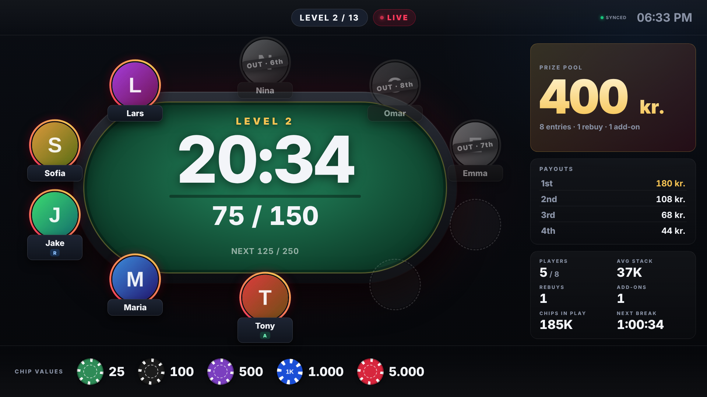
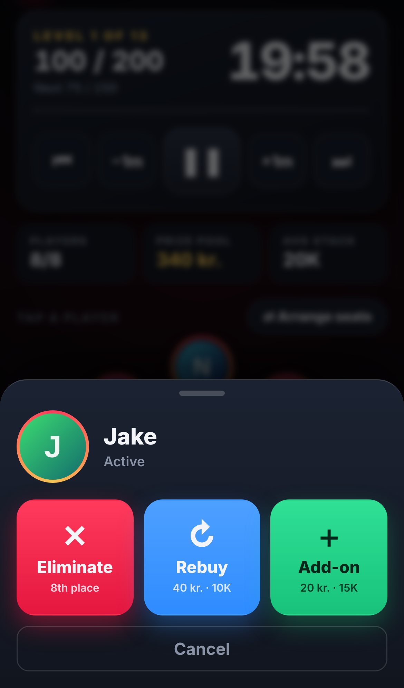
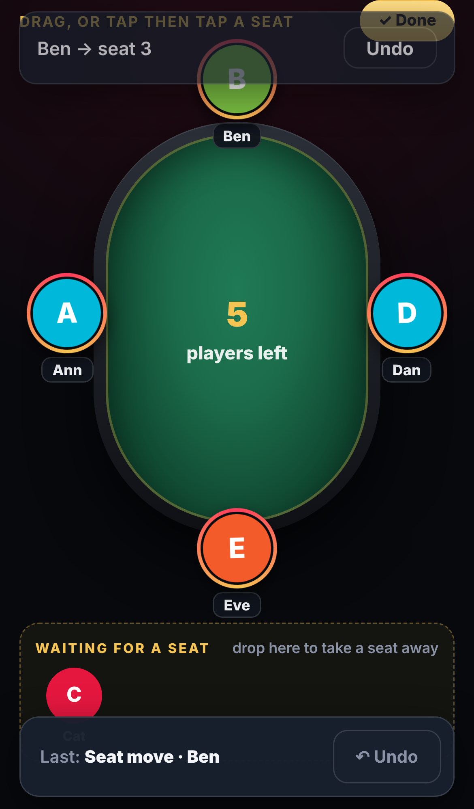

# ♠ Poker Tournament

A sleek, dark-themed home poker tournament app. The **TV display** shows a live poker table with player photos, the clock, blinds, prize pool and chip values. Your **phone is the remote**: tap a player to eliminate, rebuy or add-on, and pause or resume the clock.



| Phone remote | Tap a player | Arrange seats |
|---|---|---|
|  |  |  |

## Quick start (MacBook), no Terminal needed

1. Install **Node.js** (LTS) from [nodejs.org](https://nodejs.org). You only do this once.
2. On this GitHub page, click the green **Code** button → **Download ZIP**, then double-click the ZIP to unzip it. Move the folder somewhere handy, like Documents.
3. In the folder, double-click **`Start Poker.command`**.
   - **The very first time**, macOS blocks it because it was downloaded. **Right-click** the file → **Open** → **Open**, and it remembers after that. On newer macOS versions, if there's no Open button: System Settings → Privacy & Security → scroll down → **Open Anyway**.
   - On first start it installs what it needs (about a minute), then opens the app in your browser.
4. Keep the Terminal window that appears open while you play. Closing it stops the app.

The launcher also keeps the Mac from going to sleep during the game. Your players, photos and settings are saved in a folder called **Poker Tournament Data** in your home folder. That means you can download a newer version of the app later without losing anything.

### Install from the Terminal (no browser downloads)
Open **Terminal** (⌘ + Space, type `Terminal`, Enter) and paste **one** of these:

**If the repo is public:**
```bash
curl -fsSL https://raw.githubusercontent.com/philipjkm/Tony/main/install.sh | bash
```

**If the repo is private** (you'll be asked for a GitHub token; typing is hidden):
```bash
printf "GitHub token: "; read -s T; echo; curl -fsSL -H "Authorization: Bearer $T" https://raw.githubusercontent.com/philipjkm/Tony/main/install.sh | GITHUB_TOKEN="$T" bash
```
To make a token: github.com → your picture → **Settings** → **Developer settings** → **Personal access tokens** → **Fine-grained tokens** → **Generate new token**. Under *Repository access*, pick **Only select repositories → Tony**. Under *Permissions → Contents*, choose **Read-only**. Copy the token.

The installer puts the app in `~/Poker Tournament App` and adds **Start Poker** to your Desktop. It also adds a `poker-start` Terminal command. Run the same line again any time to update.

When it's running:

| Screen | URL | Where |
|---|---|---|
| Home (links + QR code) | `http://localhost:3000` | MacBook |
| **Settings** | `http://localhost:3000/setup` | MacBook (works on phone too) |
| **TV display** | `http://localhost:3000/display` | MacBook → TV |
| **Phone remote** | `http://<your-mac-ip>:3000/remote` | Phone (same Wi-Fi). Scan the QR code |

### Getting it on the TV
1. Open `/display` in Chrome or Safari on the MacBook.
2. Mirror to the TV with AirPlay (Control Center → Screen Mirroring), or use HDMI.
3. **Click once** on the display to go fullscreen and turn on sound (level-change chime, bust sounds).

The display is drawn at 1920×1080 and scales to fit any screen. The mouse cursor hides itself.

### Phone remote
- Scan the QR code on the home page or on the TV (it shows until the clock first starts).
- **▶ / ❚❚** starts and pauses the clock. **⏮ ⏭** go back or forward a level. **−1m / +1m** adjust the time.
- **Tap a player** to open a sheet with **Eliminate**, **Rebuy** and **Add-on**.
  - Rebuy on an eliminated player is a **re-entry**: they come back into the game.
  - A button greys out with the reason when an option isn't allowed (for example "Rebuys closed after level 4" or "Max 1 add-on reached").
- **Undo** reverses the last elimination, rebuy, add-on or seat move.
- **⚙ (top right)** has shortcuts straight into Settings: players, blinds, prize pool, payouts, chips and seats. The Settings page has a 📱 button to get back.
- Several phones can be used as remotes at the same time. Everything stays in sync.

### Seats & waiting list
Set the number of seats (2–12) in **Settings → General**. Players beyond that go on the **waiting list**, which shows at the bottom of the TV and below the table on the phone.

On the phone, tap **⇄ Arrange seats**, then either:
- **drag** a player onto a seat. Dropping onto someone swaps them, and dropping onto the waiting list takes the player off the table.
- **tap** a player, then tap where they should go.

Seat moves animate on the TV and can be undone. Tap **✓ Done** when finished.

> If the phone can't connect: make sure it's on the same Wi-Fi, and allow incoming connections for `node` if macOS asks (System Settings → Network → Firewall).

## Settings (`/setup`)
- **General**: tournament name, currency symbol, starting stack.
- **Buy-in & prize pool**: buy-in, entry fee/rake (not added to the pool), and either an **automatic** prize pool (buy-ins + rebuys + add-ons + added money, with an optional guaranteed minimum) or a **custom fixed** amount.
- **Rebuys / add-ons**: on/off, price, chips, last level allowed, max per player.
- **Payouts**: percentages or fixed amounts, with presets (winner takes all through top 6).
- **Blind structure**: edit SB / BB / ante / minutes per level, add breaks, reorder levels. Or **generate** a full structure (number of levels, minutes, starting BB, speed, antes from level X, break every N levels).
- **Players**: add names and **upload photos** (click the photo circle). Photos are resized automatically.
- **Chips**: values, colours and **chip photos** shown on the TV.

**Save changes** applies settings live without losing progress, so you can add a late player or tweak blinds mid-game. **Start new tournament** resets the clock and all eliminations, rebuys and add-ons, and keeps players and settings.

Everything is saved (state + uploaded images) to `~/Poker Tournament Data` when started with the launcher, or `data/` with `npm start`. A restart or crash picks up where you left off, paused.

## How it works
- `server.js`: Express + Socket.IO server. It owns the authoritative clock and state, persists to `data/state.json`, and handles image uploads and the QR code.
- `src/engine.js`: pure tournament logic covering the clock, levels and breaks, prize pool, payouts, places, rebuy and add-on rules, and undo.
- `public/`: plain HTML/CSS/JS pages (no build step): `display`, `remote`, `setup`, `index`.

## Tests / QA
```bash
npm test             # everything
npm run test:unit    # engine logic (20 tests)
npm run test:e2e     # real browser: settings → TV → phone (needs Playwright)
npm run test:soak    # full 4-hour game, time-compressed (~3 min, needs Playwright)
```
**Stress tests.** `test/stress.test.js` plays 300 simulated 4-hour tournaments with random, messy host actions: double taps, undo, seat shuffles, settings changes and server restarts. It checks money, places, seats and the clock after every step. `test/soak.qa.js` runs a full 4-hour game through the real server, TV and two phones at 80× speed. During that game it:
- cuts a phone's Wi-Fi, restarts the server and refreshes the TV
- sends bursts of simultaneous taps, including two phones eliminating the same player
- changes settings mid-game

Throughout, it checks the screens always match the server and that memory stays flat.

The end-to-end suite drives Settings, the TV display (1920×1080) and an iPhone-sized remote together in Chromium. It checks:
- uploads, blind generation, payouts and saving
- clock start, pause and level changes from the phone
- eliminations, re-entry, add-on and undo
- champion screen
- multi-remote sync, no JS errors, no overflow on phones
- persistence across restarts
- API hardening against bad uploads, unsafe URLs and bad actions

To run it on your Mac: `npm i -D playwright && npx playwright install chromium`. Screenshots are written to `docs/screenshots/`.
