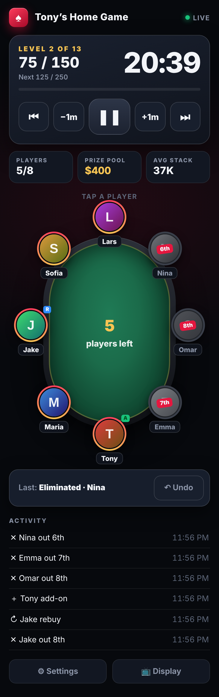

# ♠ Poker Tournament

A sleek, dark-themed home poker tournament app. The **TV display** shows a live poker table with player photos, the clock, blinds, prize pool and chip values. Your **phone is the remote**: tap a player to eliminate, rebuy or add-on, and pause or resume the clock.


| Phone remote | Tap a player |
|---|---|
|  |  |

## Quick start (MacBook)

You need [Node.js 18+](https://nodejs.org) (`brew install node`).

```bash
git clone <this repo> && cd Tony
npm install
npm start
```

The terminal prints your links:

| Screen | URL | Where |
|---|---|---|
| Home (links + QR code) | `http://localhost:3000` | MacBook |
| **Settings** | `http://localhost:3000/setup` | MacBook (works on phone too) |
| **TV display** | `http://localhost:3000/display` | MacBook → TV |
| **Phone remote** | `http://<your-mac-ip>:3000/remote` | Phone (same Wi-Fi). Scan the QR code |

### Getting it on the TV
1. Open `/display` in Chrome or Safari on the MacBook.
2. Mirror to the TV with AirPlay (Control Center → Screen Mirroring), or use HDMI.
3. **Click once** on the display to go fullscreen and turn on sound (level-change chime, bust sounds).

The display is drawn at 1920×1080 and scales to fit any screen. The mouse cursor hides itself.

### Phone remote
- Scan the QR code on the home page or on the TV (it shows until the clock first starts).
- **▶ / ❚❚** starts and pauses the clock. **⏮ ⏭** go back or forward a level. **−1m / +1m** adjust the time.
- **Tap a player** to open a sheet with **Eliminate**, **Rebuy** and **Add-on**.
  - Rebuy on an eliminated player is a **re-entry**: they come back into the game.
  - A button greys out with the reason when an option isn't allowed (for example "Rebuys closed after level 4" or "Max 1 add-on reached").
- **Undo** reverses the last elimination, rebuy or add-on.
- Several phones can be used as remotes at the same time. Everything stays in sync.

> If the phone can't connect: make sure it's on the same Wi-Fi, and allow incoming connections for `node` if macOS asks (System Settings → Network → Firewall).

## Settings (`/setup`)
- **General**: tournament name, currency symbol, starting stack.
- **Buy-in & prize pool**: buy-in, entry fee/rake (not added to the pool), and either an **automatic** prize pool (buy-ins + rebuys + add-ons + added money, with an optional guaranteed minimum) or a **custom fixed** amount.
- **Rebuys / add-ons**: on/off, price, chips, last level allowed, max per player.
- **Payouts**: percentages or fixed amounts, with presets (winner takes all through top 6).
- **Blind structure**: edit SB / BB / ante / minutes per level, add breaks, reorder levels. Or **generate** a full structure (number of levels, minutes, starting BB, speed, antes from level X, break every N levels).
- **Players**: add names and **upload photos** (click the photo circle). Photos are resized automatically.
- **Chips**: values, colours and **chip photos** shown on the TV.

**Save changes** applies settings live without losing progress, so you can add a late player or tweak blinds mid-game. **Start new tournament** resets the clock and all eliminations, rebuys and add-ons, and keeps players and settings.

Everything is saved to `data/` (state + uploaded images), so a restart or crash picks up where you left off, paused.

## How it works
- `server.js`: Express + Socket.IO server. It owns the authoritative clock and state, persists to `data/state.json`, and handles image uploads and the QR code.
- `src/engine.js`: pure tournament logic covering the clock, levels and breaks, prize pool, payouts, places, rebuy and add-on rules, and undo.
- `public/`: plain HTML/CSS/JS pages (no build step): `display`, `remote`, `setup`, `index`.

## Tests / QA
```bash
npm test             # everything
npm run test:unit    # engine logic (17 tests)
npm run test:e2e     # real browser: settings → TV → phone (needs Playwright)
```
The end-to-end suite drives Settings, the TV display (1920×1080) and an iPhone-sized remote together in Chromium. It checks:
- uploads, blind generation, payouts and saving
- clock start, pause and level changes from the phone
- eliminations, re-entry, add-on and undo
- champion screen
- multi-remote sync, no JS errors, no overflow on phones
- persistence across restarts
- API hardening against bad uploads, unsafe URLs and bad actions

To run it on your Mac: `npm i -D playwright && npx playwright install chromium`. Screenshots are written to `docs/screenshots/`.
